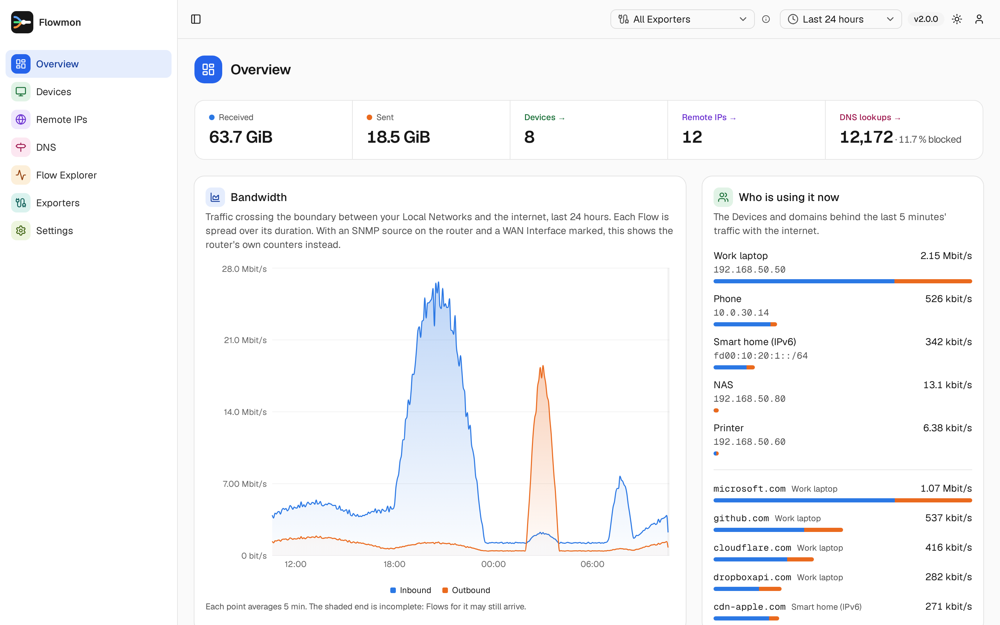
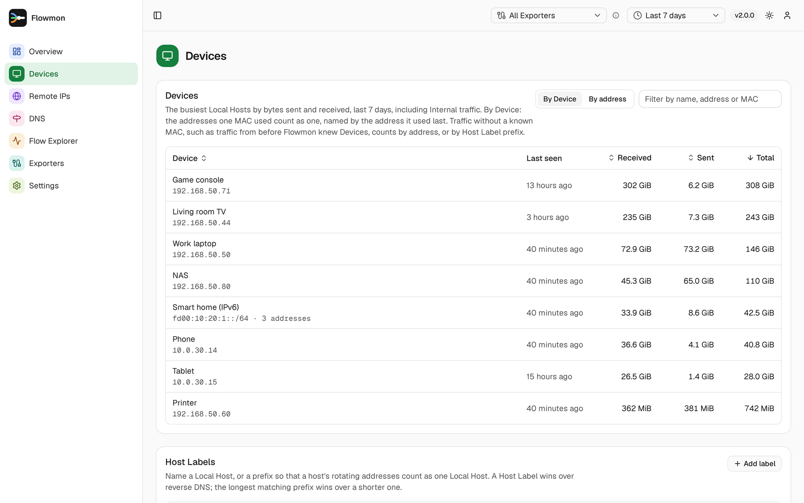
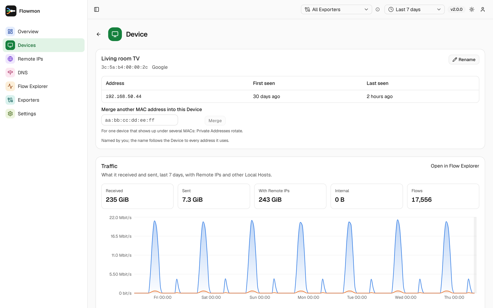
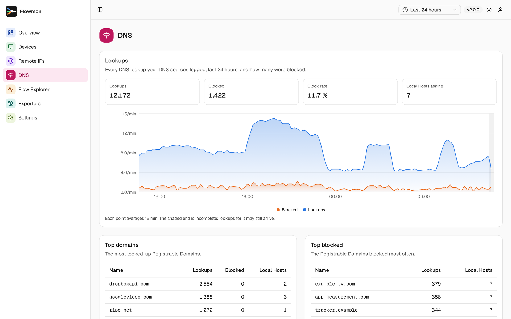
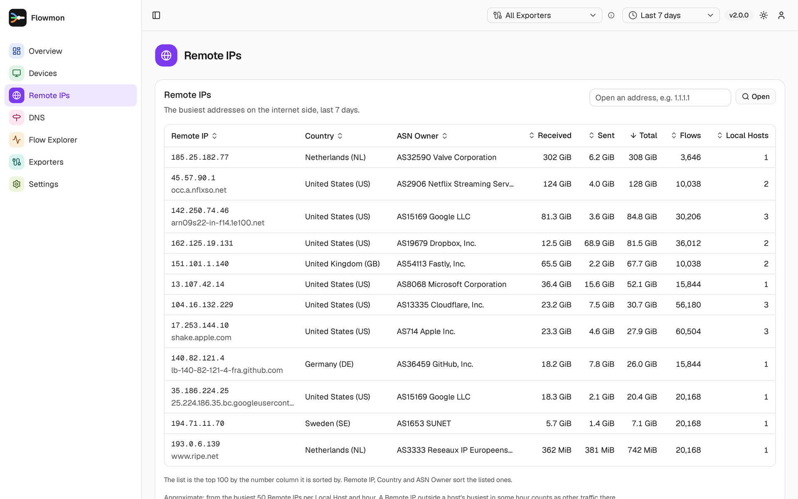
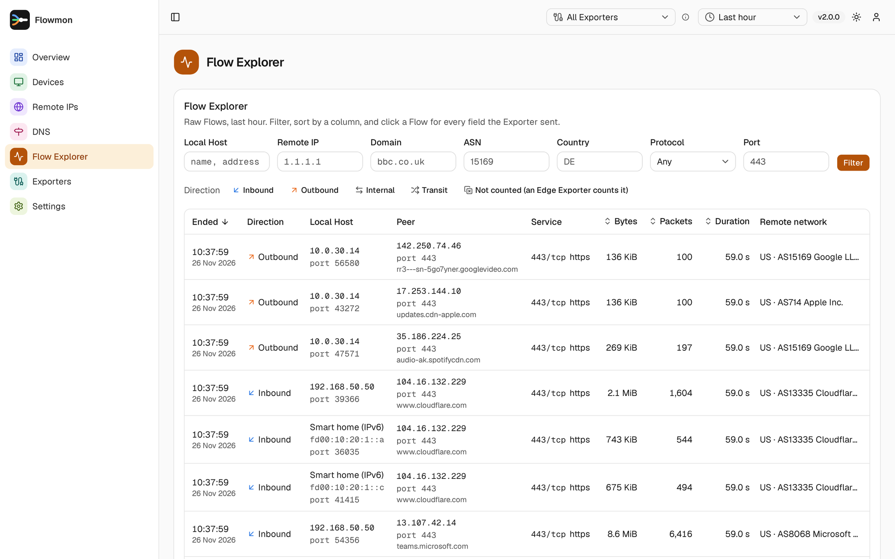
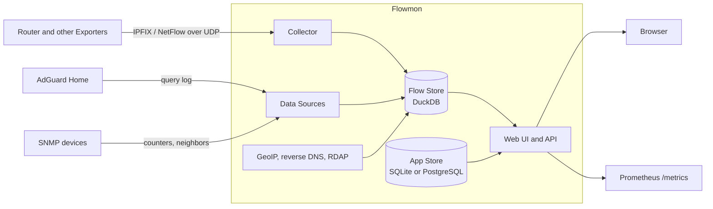

<p align="center">
  <picture>
    <source media="(prefers-color-scheme: dark)" srcset="docs/images/logo-dark.svg">
    
  </picture>
</p>

<p align="center">
  <b>See where your home or lab network's traffic goes, which device sent it, and what it was for.</b>
</p>

<p align="center">
  <a href="https://github.com/jkop-xyz/flowmon/actions/workflows/ci.yml"></a>
  <a href="https://github.com/jkop-xyz/flowmon/releases/latest"></a>
  <a href="https://github.com/jkop-xyz/flowmon/pkgs/container/flowmon"></a>
  
  <a href="LICENSE"></a>
</p>

<p align="center">
  <picture>
    <source media="(prefers-color-scheme: dark)" srcset="docs/images/overview-dark.png">
    
  </picture>
</p>

Flowmon is a self-hosted dashboard for network traffic. It collects IPFIX and NetFlow from your router (MikroTik first, but any exporter that follows the standard). It puts names on both ends of each Flow: the Device on your side, from its MAC address, and the country, ASN Owner, reverse DNS and domain on the other. Add AdGuard Home and SNMP, and it shows every DNS lookup and the router's own view of the line.

It is one container with an embedded database. Point your router at it and open the browser.

## Features

**Traffic**
- Receives IPFIX, NetFlow v9 and NetFlow v5 over UDP, including biflows (RFC 5103) and sampled exports, which are scaled up and marked as estimates.
- Stores raw Flows and minute and hour Rollups in an embedded DuckDB, each with its own retention, under one `/data` volume.
- Gives every Flow a direction (inbound, outbound, internal or transit) from the router's Interface Roles. Internal Exporters, such as a hypervisor, add the traffic the router can't see without counting anything twice.
- The Flow Explorer filters, sorts and pages raw Flows, and it shows every field each Flow arrived with.

**Devices and Local Hosts**
- Finds each Flow's Device from the MAC addresses in the record, with vendor names from the IEEE registries. A Device keeps its name when its address changes, and Private Addresses that rotate can be merged into one Device.
- Host Labels name an address or a whole prefix, such as the `/64` of an IPv6 network whose addresses rotate. Otherwise names come from reverse DNS against your own resolver.
- Each Device and Local Host has a page with its traffic over time, its peers and its Service Ports.

**The internet side**
- Each Remote IP has its country and ASN Owner, from GeoIP, its reverse DNS name, and its registration details from RDAP.
- A world map and top lists of countries, ASN Owners, Remote IPs and Service Ports, also for ranges older than raw retention.
- Domain Attribution matches Flows to the domains that were looked up, grouped by Registrable Domain from the Public Suffix List.

**DNS from AdGuard Home**
- Collects AdGuard Home's query log: every lookup, which Device asked, and what was blocked.
- Flags DNS that goes around AdGuard Home.

**SNMP**
- Polls any device over SNMP v3 or v2c each minute: every interface's traffic, errors and status, plus device health.
- Reads ARP and IPv6 neighbor tables, so quiet devices are listed too.
- On the router, the Overview shows the line's load from the router's own counters, against the line speed you set. Reconciliation compares those counters with the bytes in Flows and flags a gap.

**Running it**
- One image for `linux/amd64` and `linux/arm64`. Accounts and settings live in built-in SQLite or your own PostgreSQL.
- Online Flow Store backups, `/metrics` for Prometheus, collector health with kernel drop counts, and a warning when Flows stop arriving.
- Light and dark mode, and layouts for wide monitors and narrow windows.

<table>
  <tr>
    <td width="50%">
      <picture>
        <source media="(prefers-color-scheme: dark)" srcset="docs/images/devices-dark.png">
        
      </picture>
      <p align="center"><b>Devices</b>, by MAC address or by Host Label prefix</p>
    </td>
    <td width="50%">
      <picture>
        <source media="(prefers-color-scheme: dark)" srcset="docs/images/device-dark.png">
        
      </picture>
      <p align="center">A <b>Device</b> with its addresses and traffic</p>
    </td>
  </tr>
  <tr>
    <td width="50%">
      <picture>
        <source media="(prefers-color-scheme: dark)" srcset="docs/images/dns-dark.png">
        
      </picture>
      <p align="center"><b>DNS</b> lookups and blocks from AdGuard Home</p>
    </td>
    <td width="50%">
      <picture>
        <source media="(prefers-color-scheme: dark)" srcset="docs/images/remote-dark.png">
        
      </picture>
      <p align="center"><b>Remote IPs</b> with country, ASN Owner and reverse DNS</p>
    </td>
  </tr>
  <tr>
    <td colspan="2">
      <picture>
        <source media="(prefers-color-scheme: dark)" srcset="docs/images/flows-dark.png">
        
      </picture>
      <p align="center">The <b>Flow Explorer</b>: every raw Flow, filtered and sorted</p>
    </td>
  </tr>
</table>

<sub>Screenshots use generated data.</sub>

## Run it

```sh
docker run -d --name flowmon --network host -v flowmon-data:/data --restart unless-stopped ghcr.io/jkop-xyz/flowmon:latest
```

Then open <http://localhost:8080>. The first visit runs setup: enter the one-time setup token from the logs (`docker logs flowmon`), choose where accounts and settings live (built-in SQLite, or your own PostgreSQL), and create the admin account. Forgot the password? `docker exec -it flowmon flowmon admin reset-password admin`.

Next, point your router's flow export at the host on UDP port 2055 or 4739. Setting up a MikroTik? See [docs/mikrotik-setup.md](docs/mikrotik-setup.md), which is also in the app, linked from the Exporters page. A new Exporter waits for your approval on the Exporters page.

Or use [`compose.yaml`](compose.yaml), or the Podman Quadlet in [`deploy/podman/`](deploy/podman). [docs/deploy.md](docs/deploy.md) explains both, plus host networking, the UDP buffer setting, backups and updates.

> [!IMPORTANT]
> An update can't be undone by starting the older image. Back up `/data` before you update, or pin a version's tag, such as `:2`, instead of `latest` ([how](docs/deploy.md#updating)).

## How it works



The Flow Store holds Flows, Rollups, DNS Queries and Interface Counters on the `/data` volume. The App Store holds accounts, settings, Data Sources and the names you give Devices and hosts. It can live in your own PostgreSQL. [docs/adr/](docs/adr) records why it is split this way.

## Documentation

| | |
|---|---|
| [Running Flowmon](docs/deploy.md) | Docker, Podman, host networking, GeoIP, reverse DNS, AdGuard Home, backups and updates |
| [Configuration](docs/configuration.md) | Every environment variable, SNMP and Reconciliation, supported exports, debug capture |
| [MikroTik setup](docs/mikrotik-setup.md) | Traffic Flow, Interface Roles and SNMP on RouterOS |
| [Internal Exporters](docs/internal-exporters.md) | Adding a hypervisor's traffic without counting anything twice |
| [Glossary](GLOSSARY.md) | What Flow, Exporter, Local Host, Device and the other terms mean here |

IPFIX over TCP and SCTP, and RFC 6313 structured lists, come later. [Issue #1](https://github.com/jkop-xyz/flowmon/issues/1) tracks them.

## Develop

You need Go 1.27 and Node 26.

```sh
make build        # build the UI, then bin/flowmon with the UI embedded
make test         # Go vet and tests, frontend lint
make dev          # run the server on :8080
cd web && npm run dev   # UI with hot reload on :5173, proxying /api to :8080
go run ./internal/devtools/sendipfix -addr 127.0.0.1:4739   # synthetic MikroTik-like IPFIX
go run ./internal/devtools/sendipfix -addr 127.0.0.1:2055 -version 9   # the same as NetFlow v9 (or -version 5)
go run ./internal/devtools/fakeadguard   # a fake AdGuard Home on 127.0.0.1:3001 (admin / admin)
```

Captures of real exporters (`.pcap`, from tcpdump or `FLOWMON_DEBUG_CAPTURE`) go in [`internal/collector/testdata/captures/`](internal/collector/testdata/captures). `go test ./internal/collector` decodes each one and checks that every record becomes a Flow with the times the exporter gave.

The design lives in [`GLOSSARY.md`](GLOSSARY.md) (the domain language) and [`docs/adr/`](docs/adr) (the decisions and why they were made).

## Licence

[Apache-2.0](LICENSE). Flowmon uses GeoIP data from MaxMind GeoLite2 (downloaded with your own licence key) or [DB-IP](https://db-ip.com) Lite (CC BY 4.0, attribution shown in the UI), or files you provide; see [docs/deploy.md](docs/deploy.md#geoip-databases). Neither is bundled in the image. The world map uses [Natural Earth](https://www.naturalearthdata.com) shapes (public domain) via world-atlas.
